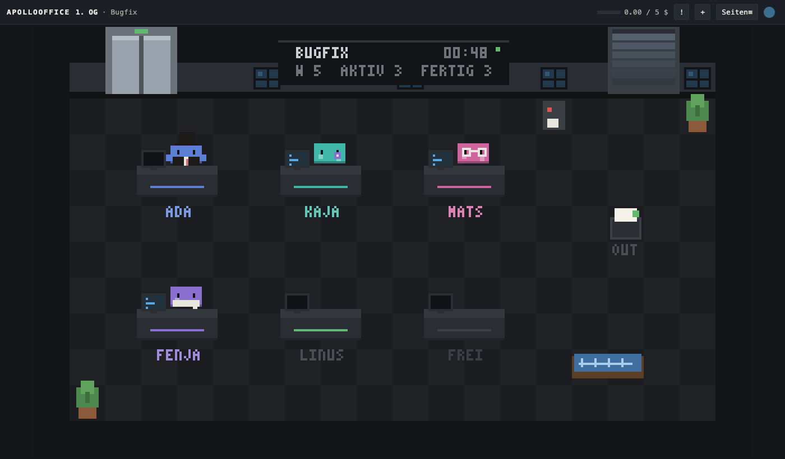
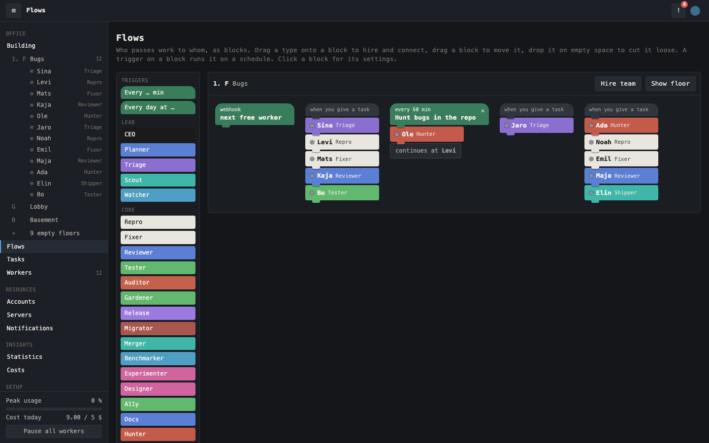
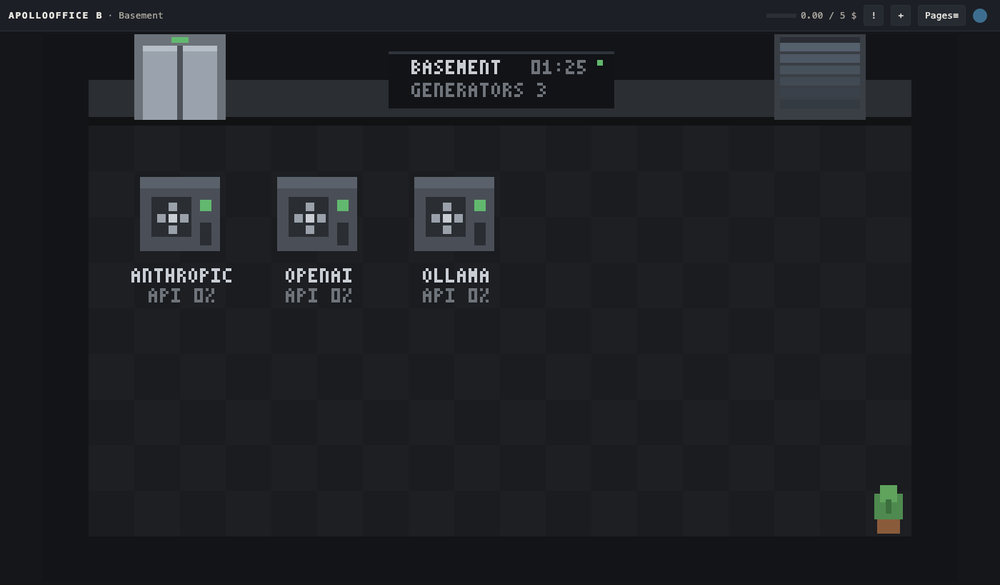
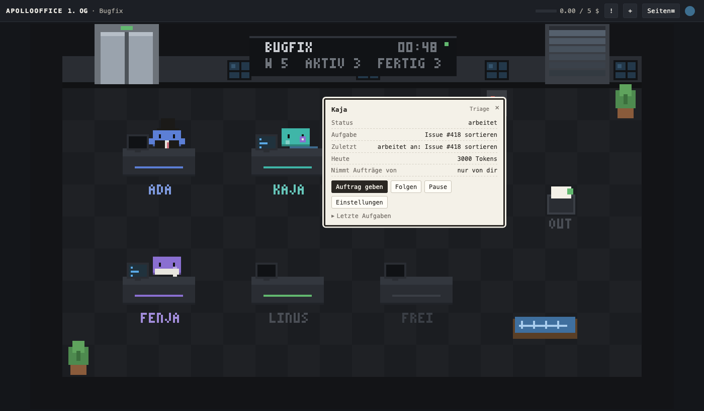
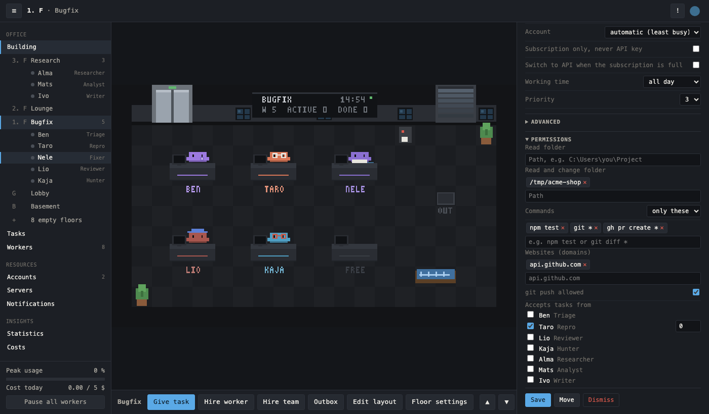
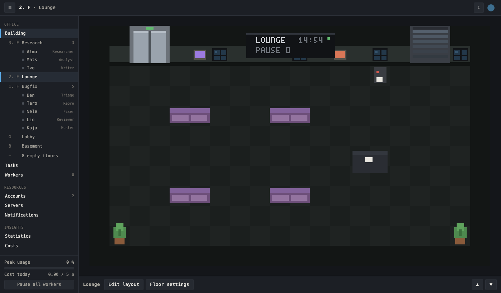
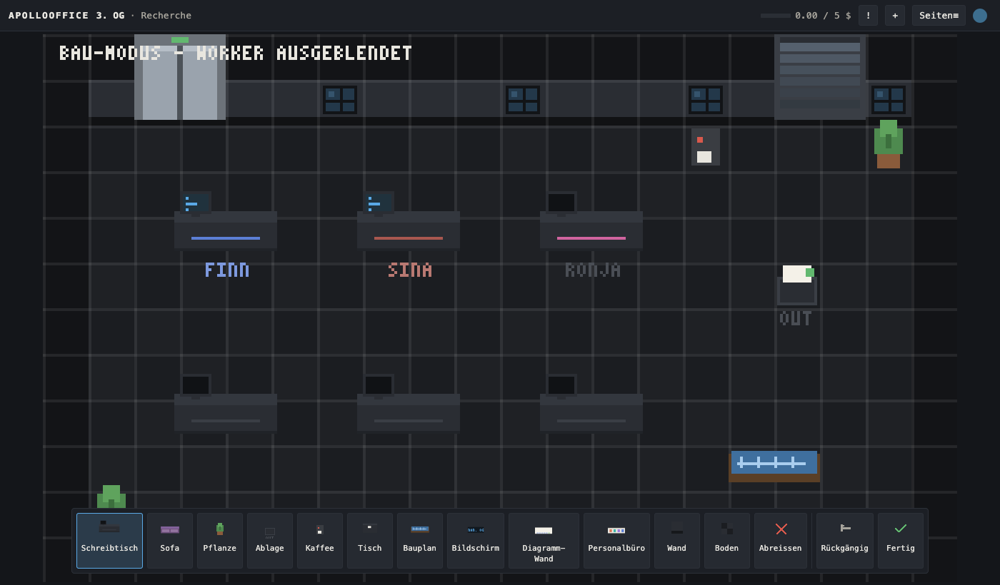
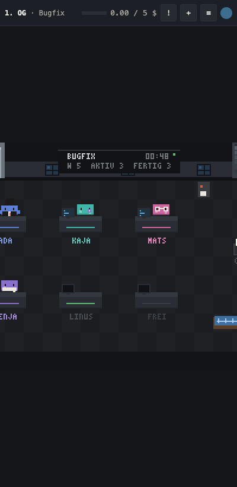

<p align="center">
  
</p>

<h1 align="center">ApolloOffice</h1>

<p align="center">
  A pixel skyscraper full of AI workers that runs on your own computer.
  Hire workers, give them folders and rules, hand out tasks, and watch them
  walk to their desks and get it done.
</p>

<p align="center">
  <a href="LICENSE"></a>
  
  
  
  
</p>



Every account you connect is a generator in the basement. Every floor is a
room you build yourself: offices, a lounge, a server room, accounting. Workers
are little pixel people with a role, a model and rights you can see. They pick
up tasks, use the tools you allowed, pass work to colleagues who accept orders
from them, and drop results into the OUT tray.

> [!NOTE]
> This is an early release. Workers run on your own Claude or ChatGPT
> subscription, or on API keys you add. Nothing leaves your machine except the
> calls the models make, the websites you allow, and the login.

> [!WARNING]
> ApolloOffice is not secure. It lets AI models read files, run commands and
> send messages on your computer. Prompt injection is always possible: text
> from a web page, an issue, a webhook or a mail can make a worker do things
> you did not want, and every safeguard here can fail. Only give workers what
> you could afford to lose. You use it at your own risk; the authors accept no
> liability for any damage, cost or data loss (see sections 15 and 16 of the
> [license](LICENSE)).

## What's inside

- **The building.** 11 to 18 floors, random at first, more whenever you want.
  Unbuilt floors become an Office, Lounge, Server room or Accounting with one
  click. A lift and stairs connect them.
- **Workers.** Many types come with it (CEO, Scout, Triage, Hunter, Repro, Fixer,
  Reviewer, Shipper, Tester, Writer, Researcher, Analyst, Ops, Reporter), and
  you can build your own in the HR office. One click hires a whole team:
  Bugfix (from issue or bug hunt to a pull request), Research or Writing.
- **One place for everything.** The sidebar holds the building with every
  floor and worker, plus tasks, workers, accounts, servers, notifications,
  statistics, costs, worker types, the lab and settings. The bar under each
  floor has what you can do there. Whatever you click opens in the panel on
  the right.
- **Flows as blocks.** The Flows page shows who passes work to whom as
  Scratch-style stacks. Drag a worker type under a block to hire and connect
  it, drag a trigger on top to run it every hour or every morning. Under the
  hood it is still a simple rule: "takes orders from Repro" on the Fixer.
  Orders never carry rights: the Fixer always works with its own folders and
  commands.
- **Accounts in the basement.** Claude Code (Claude subscription), Codex CLI
  (ChatGPT subscription) and API keys for Anthropic, OpenAI, Gemini,
  DeepSeek, Mistral, OpenRouter, Groq, Ollama or LM Studio. Several
  accounts per provider; workers can pick the one with the most room left.
  A generator runs, stutters when nearly full and stops at its limit.
- **Server room.** Add a Linux server with an address and one admin login.
  ApolloOffice creates a restricted `apollo` user with its own key and only
  uses that afterwards. Jobs run in Docker when it is there, plain otherwise.
  Workers never get free SSH, only the commands you allow on that server.
- **Notifications.** Discord, ntfy, Telegram, e-mail over SMTP, any webhook
  or the desktop. Pick per event where it goes: task done, failed or
  rejected, daily cost cap, account error, server offline, update. Nothing is
  on by default. Workers with the notify tool can send too.
- **Build mode.** A grid, a palette of furniture, walls and floors, undo. All
  workers are hidden while you build.
- **Statistics.** Widgets with numbers, lists, charts and lamps from the
  building, HTTP JSON, GitHub, uptime or RSS. A lab to try prompts.
- **Start quest.** Pia at the reception walks you through power, first office,
  first worker, first task and first result. After that you are on your own.



| Basement | Worker | Rights |
| --- | --- | --- |
|  |  |  |

| Lounge | Build mode | Phone |
| --- | --- | --- |
|  |  |  |

## Install

1. Download the binary for your system from the
   [releases](https://github.com/Silvertree2010/ApolloOffice/releases).
2. Start it in a terminal:

   ```
   apollo-office
   ```

3. Open `http://127.0.0.1:47300` and sign in with GitHub, Google, GitLab or
   Discord. The first login owns the installation.

For subscriptions you need the matching CLI, logged in:
[Claude Code](https://claude.com/claude-code) or Codex CLI. Gemini works
with an API key; Google no longer lets Gemini CLI run on personal Google
logins. On
Windows workers run shell commands through Git Bash, so install
[Git for Windows](https://git-scm.com) if you want them to run commands.

Windows SmartScreen warns about the binary because it is not signed yet.

To start ApolloOffice when you log in:

```
apollo-office autostart on
```

## Commands

```
apollo-office                     run (options: --port, --bind, --data, --quiet)
apollo-office login-link          one-time login link, valid 10 minutes
apollo-office reset-owner         release the owner, the next login binds again
apollo-office autostart on|off
apollo-office export <file>       everything except credentials
apollo-office import <file>
apollo-office status
```

Data lives in `%APPDATA%\ApolloOffice` on Windows,
`~/Library/Application Support/ApolloOffice` on macOS and
`~/.local/share/apollo-office` on Linux. A backup of the database is made
every day, the last seven are kept.

## Good to know

**Security.** ApolloOffice lets models act on your computer, so it is built
around limits you can see and confirm:

- Workers start fresh for every task, as headless CLI sessions without their
  own tools, hooks, plugins or memory, or in ApolloOffice's own agent loop for
  API keys. They only get the tools of their type.
- File tools only reach the folders you gave that worker and its floor's tray.
  Paths are resolved through symlinks before they are checked.
- Shell commands must match the patterns you allowed. Chained commands are
  checked part by part; `sudo`, credential stores, SSH keys, destructive `rm`
  and `curl | sh` are always blocked. `git push` needs its own permission.
- Web access only goes to domains you allowed. Answers from the web are marked
  as untrusted for the model.
- Text from outside (webhooks) is screened by Guard, a small model, before a
  worker sees it. Guard lowers the risk of prompt injection but is not perfect.
- Giving rights, adding servers and changing credentials always shows a
  dialog that says in one sentence what can happen.
- Credentials are encrypted with AES-256-GCM; the key sits in the system's
  credential store. Keys are never shown again and never given to workers.
- The web interface listens on `127.0.0.1` only. Logins, rights and
  credentials end up in an audit log.
- Custom tools are JavaScript in an embedded QuickJS sandbox without file,
  network or process access except through `ctx`, with the worker's rights.

What remains: a worker allowed to run "any command" can do anything your user
can do, and Codex CLI keeps read-only access of its own to the files your
user can read. On Linux the encryption key sits in a file readable only by
your user, since there is often no credential store.
Only allow that where it is fine.

**Notifications.** Channels are set up in the settings; their addresses and
tokens are encrypted like other credentials. Workers only pick a channel by
name and never see the address. Each channel sends at most 10 messages a
minute, and the same message twice within 10 minutes goes out once. A worker
can forward text from outside, so a notification may contain anything a web
page or webhook said.

**Login.** The login runs through `auth.apollonet.dev`, a small Cloudflare
Worker without storage ([source](auth/)). It learns who signs in and nothing
else, and hands your installation a short token signed with Ed25519 and bound
to the installation's address. Everything else stays on your computer.

**Cost.** Subscriptions are used within their limits. For API keys there is a
hard daily stop across all keys (5 USD by default) and optional limits per
account and per worker. Workers never switch to an API key on their own unless
you tick "use API when the subscription is full".

**Updates.** ApolloOffice checks GitHub for a new release every 6 hours,
verifies it against a signature built into the binary, and installs it when no
task is running. Then it restarts by itself. This is on by default; turn it off
in the settings. Apart from that check there is no telemetry.

## Build from source

```sh
git clone https://github.com/Silvertree2010/ApolloOffice.git
cd ApolloOffice
cargo build --release
```

```sh
cargo test      # unit tests and end-to-end runs against a fake model and a fake Claude CLI
```

## AI disclosure


The idea, the spec and the decisions are mine. The code was written by
Claude (Opus 5.5) from that spec and tested before release. The pixel figures
come from ClawdCrab by the same author.

| Part | Done by |
| --- | --- |
| Idea, spec, design decisions | Me |
| Code and tests | Claude |
| Commits | Claude |

## License

[AGPL-3.0](LICENSE) © 2026 Silvertree2010. Contributions are welcome.
