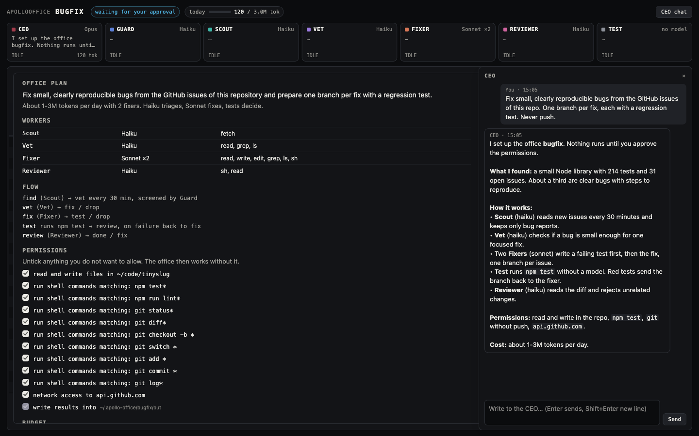
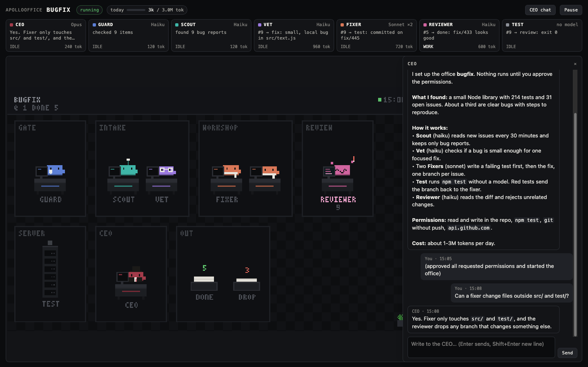
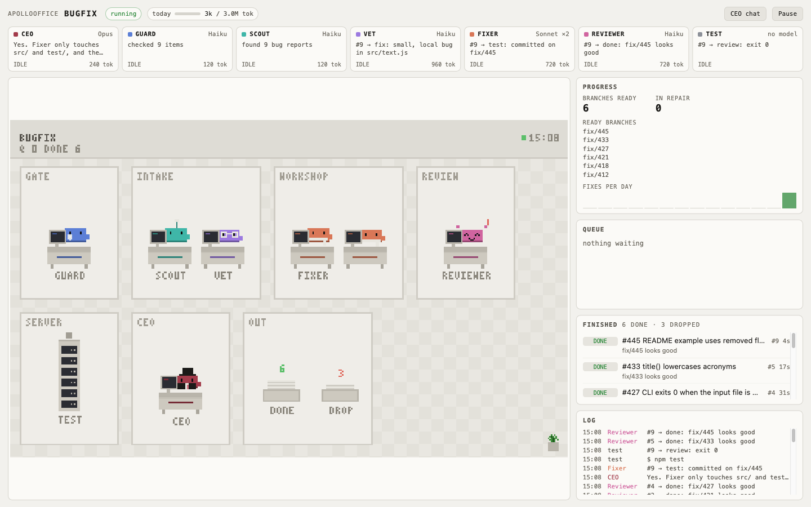

<p align="center">
  
</p>

<h1 align="center">ApolloOffice</h1>

<p align="center">
  A local office of Claude workers. Give the CEO a task: it hires the team,
  builds the pipeline and the dashboard, and runs it on your own Claude account.
</p>

<p align="center">
  <a href="LICENSE"></a>
  
  
  
  
</p>


You describe a job, for example "fix the small bugs from our GitHub issues"
or "collect the pricing pages of 30 note-taking apps". The CEO (Opus) reads
the task and your folder, decides which workers it needs, writes their
prompts, its own tools and checks, and lays out the office. You see the plan,
untick what you don't want to allow, and press Start. Then you watch the
office work in a small pixel building in your browser.

> [!NOTE]
> This is an early release. Every office runs on your own Claude Code login,
> so it uses your plan's limits. Nothing leaves your machine except the calls
> Claude Code makes and the domains you approve.

It grew out of a private office that fixes bugs in open-source repos.
ApolloOffice is the general version: the CEO builds a new office for every
task instead of running one fixed pipeline.

If you like it, a star on GitHub helps other people find it.

## What's inside

- **The CEO** designs the office, answers your questions in the chat and
  checks on the office every hour. When something goes wrong it changes
  prompts, checks or stages by itself.
- **Workers** with their own role, model, prompt and tools. Haiku for
  searching, sorting and checking, Sonnet for code and careful text, Opus only
  where the CEO thinks it is worth it.
- **Stages** that move work along: sources that find new items on a timer,
  work stages for a worker, code stages that run a command like `npm test`
  without a model.
- **Checks** written as small scripts. A failed check sends the item back with
  the reason, so the worker can fix it.
- **Guard** screens text from outside (web pages, issues, mails) for prompt
  injection before any worker sees it.
- **Permissions you can see.** Every folder, command pattern and domain is a
  checkbox. The office works with whatever you leave ticked.
- **Budget.** A daily token limit, a limit on parallel workers and a highest
  allowed model. When your Claude plan hits its limit, the office waits for the
  reset.
- **Dashboard** with live worker cards, the pixel office, queue, results, log
  and progress tiles the CEO picks for the task. Light and dark.

| Plan review | CEO chat | Light mode |
| --- | --- | --- |
|  |  |  |

## Install

You need [Claude Code](https://claude.com/claude-code) (logged in) and
**Node.js 22.18** or newer. Tested on macOS.

**As a Claude Code plugin:**

```
/plugin marketplace add Silvertree2010/ApolloOffice
/plugin install apollo-office@apollo-office
```

Then ask Claude for an office, or use the skill directly:

```
/office new docs-sweep "Find outdated install instructions in docs/ and rewrite them" --dir ~/code/my-app
```

**From source:**

```sh
git clone https://github.com/Silvertree2010/ApolloOffice.git
cd ApolloOffice
bin/office new research "Collect pricing pages of 30 note-taking apps and write out/pricing.md" --dir ~/notes
```

No build step and no dependencies: plain Node with type stripping.

## How it works

1. `office new` starts a small local daemon on `127.0.0.1:47300` and opens
   the dashboard.
2. The CEO reads your task and your work folder. It may ask questions in the
   chat. Then it writes a plan: workers, stages, checks, custom tools, layout,
   budget and the permissions it needs.
3. You review the plan. Untick any permission you don't want.
4. You press **Start office**. Workers pick up items stage by stage until they
   are done or dropped.
5. The CEO audits the office every hour. If a fix needs new permissions, the
   office pauses until you approve them.

Results go to `~/.apollo-office/<name>/out/` unless the task says otherwise.
The plan format is in [prompts/plan.md](prompts/plan.md), and
[examples/github-bugfix.json](examples/github-bugfix.json) is the complete
plan of the office in the screenshots.

## Commands

```
office new <name> "<task>" [--dir <folder>] [--no-open]
office list | status [<name>] | open <name> | url <name>
office chat <name> "<message>"
office start <name>          approve everything requested and start (the dashboard is the better place)
office pause <name> | resume <name> | rm <name>
office daemon | quit
```

## Good to know

**Security.** ApolloOffice lets a model write code that runs on your machine,
so it is built around limits you can see:

- Workers run as headless Claude Code sessions without your hooks, plugins,
  CLAUDE.md or memory, and with no built-in tools. They only get the office
  tools their role needs.
- File tools only reach the folders you approved and the office `out/` folder.
- Shell commands must match the approved patterns. Chained commands are checked
  part by part, command substitution needs full shell access, and `sudo`,
  credential stores, SSH keys and destructive `rm` are always blocked.
  `git push` and `gh` need their own approval.
- Network access only goes to approved domains.
- Custom tools and checks run in a separate Node process with the Node
  permission model, without direct network, child processes or native addons.
- The dashboard only listens on 127.0.0.1 and rejects requests from other
  origins.

What remains: with "any shell command" approved, a worker can do anything your
user can do. Only approve that for folders and tasks where this is fine.
Prompt-injection screening lowers the risk but isn't perfect, so be careful
with offices that read untrusted text and can also write, run commands or push.

**Cost.** The CEO estimates the tokens per day in the plan, and the daily
limit stops the office when it is reached. ApolloOffice never switches to an
API key on its own.

**Privacy.** No telemetry, no accounts. Offices, logs and results live in
`~/.apollo-office/`. Delete that folder to reset everything.

## Development

```sh
npm test        # engine, permissions, sandbox and an end-to-end run against a fake Claude
npm run daemon  # run the daemon in the foreground
```

## AI disclosure


The idea, the spec and the decisions are mine. The code was written by
Claude (Opus 5.5) from that spec and tested against real offices before
release. The pixel figures come from ClawdCrab by the same author.

| Part | Done by |
| --- | --- |
| Idea, spec, design decisions | Me |
| Code and tests | Claude |
| Commits | Claude |

## License

[AGPL-3.0](LICENSE) © 2026 Silvertree2010. Contributions are welcome.
